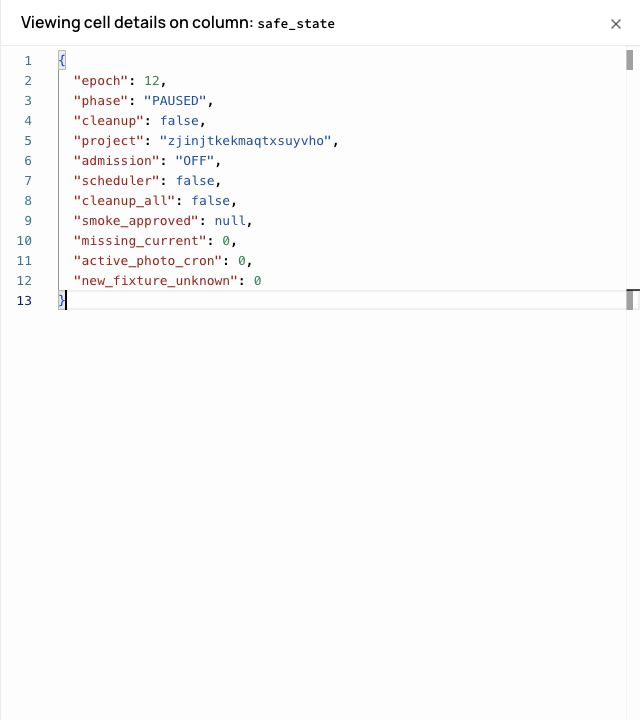

# PHOTO canary fixture repair — 2026-10-18

**Gate: NO-GO alla riapertura PHOTO e al proseguimento della roadmap.**
Fixture repair verificato; unica iterazione live interrotta al delete gate. Nessun secondo tentativo.

## Scope e baseline

Branch `codex/soma-schema-v2-staging`, parent `99ae0288448c53e8f017997a82e0b79127f0a36d`.
Solo Supabase staging `zjinjtkekmaqtxsuyvho`. Runtime Preview invariato, SHA
`305cb4f8e625e9d331fd382089853ab350fe8cf5`, deployment `dpl_HbkVAv5TPEJa63RnuqXZNibMpaMi`:
https://spot-4iyv0pnke-fedegrasso1994-1482.vercel.app . Nessun nuovo deploy necessario: modificati solo harness, test ed evidenze.

Nessuna modifica a validatori/decoder, limiti, canonicalizzazione, lifecycle, admission policy,
UI, PHOTO-01/02, main o produzione. Nessuna migration, nessun deploy Edge, nessun Spot v2.
Main locale/remoto verificato `d0f515e8d2c80eeae60f2d5c33dd8901558d5287` prima del push staging.
Nessun accesso a GCP o a chiavi amministrative/service-role. Auth reale delle sole due fixture
tramite password temporanee già esistenti e public key staging; credenziali solo in manifest locale ignorato.

## Root cause esatta della vecchia fixture

La JPEG 64×64 seed 40 prodotta da `jpeg-js@0.4.4` era lunga 1763 byte.
Magic/header JPEG, RGB8, dimensioni e tipo effettivo erano corretti; nessun mismatch MIME o metadato responsabile.
Il decoder permissivo jpeg-js riusciva a leggerla, ma questo non dimostrava la conformità del payload.

L'encoder termina con `bytepos=7`, quindi già allineato al byte. La condizione
`if (bytepos >= 0)` aggiunge comunque otto bit a uno e lo stuffing produce una coppia
`FF 00` prima di `FF D9`. La scansione rigorosa PHOTO-01 raggiungeva la fine dei blocchi a
1759 byte e respingeva quell'entropia aggiuntiva con `INVALID`, prima di decode raster/Storage.
Riproduzione deterministica conservata nel test esistente `photo-canary-fixture-contract.test.js`.
Non è stato allentato il validator né modificato jpeg-js.

## Fixture riparate e prevalidazione

Generator versionabile `tests/fixtures/photo-canary-generator.mjs`, usando ImageScript 1.3.1,
già devDependency. Gradienti sintetici RGB 320×240, JPEG qualità 85, nessuna foto reale o metadata utente.
Cinque seed espliciti, generazione deterministica; estensione e contenuto realmente JPEG.

Prima di qualsiasi Auth/network il runner chiama `preflightCanaryFixtures`: stesso parser,
`validateJpegPayload`, decoder e bounded canonical encoder usati dal server PHOTO-01, invariati.
Le uscite vengono controllate come nella pipeline server: JPEG/header/orientation; non viene attribuita
alla pipeline una validazione entropy degli output che il contratto attuale non esegue.

| Seed | Byte input | Input validation + decode/canonicalizzazione |
|---|---:|---|
| 10 | 9464 | PASS |
| 20 | 9175 | PASS |
| 30 | 9497 | PASS |
| 40 | 7148 | PASS |
| 41 | 9475 | PASS |

Seed 40 SHA-256: `5f1a68c2a0a4e477e7539a037a6b73c640b6c30e675dc2d581631f98b561aa7d`.
Test aggiunto: tutti i seed attraversano il percorso completo invariato, header/dimensioni,
limite fixture <20 KB, entropia input, ripetibilità byte-per-byte, hash seed 40, seed non autorizzato rifiutato.
Il runner esige manifest esplicito e impedisce il resume automatico di un tentativo marcato stopped.
Vecchio manifest stopped preservato; nuovo manifest separato correlato tramite checksum, senza token salvati.

## Unica iterazione live autorizzata

Preflight admission PAUSED: login reale A/B, dichiarazione AGE e consenso delle sole fixture,
upload rifiutati 503 `PAUSED`, `Cache-Control: no-store`, nessuna nuova scrittura: **PASS**.
Controller esistente, guardie staging/epoch11/current/unknown/cron e sola allowlist A/B:
`PAUSED → CANARY`, cleanup globale e scheduler sempre OFF.

| Gate reale | Esito |
|---|---|
| B nuovo upload JPEG seed40, canonicale e tre copie scaricabili | PASS |
| B INSERT profilo; onboarding completo con Tribe opzionale saltata | PASS |
| A profilo esistente: UPDATE metadati durante upload concorrente | PASS |
| A foto precedente leggibile durante e dopo replace; nuova valida | PASS |
| B file invalido respinto, retry JPEG seed41 e replace valido | PASS |
| B delete-account immediato | **HTTP 409 — gate non superato** |
| Approve smoke / admission OPEN | NON ESEGUITI |
| E2E UI completo, refresh/sessione dopo riapertura, Ora/Tribe live | NON ESEGUITI: stop al gate |

### Perché il delete ha risposto 409

Il test negativo crea un job `failed` con la lease conservativa di 45 secondi prevista dal lifecycle.
Il runner chiedeva delete immediatamente dopo il retry valido: il precedente job failed aveva ancora
`lease_until > delete.created_at`. SQL read-only successivo conferma `blocked_at_delete=true`
per quel job e writer delle fixture tutti settled. `photo_deletion_barrier` considera esplicitamente
job processing/failed con lease viva; l'endpoint restituisce 409 prima del purge.

Non è un nuovo JPEG INVALID o una perdita foto. È un ordine temporale del runner incompatibile
con il gate conservativo esistente. Il runner precedente stampava solo `body.code`, mentre delete
usa `body.error`: il testo esatto HTTP non è stato conservato; l'attribuzione è supportata dal ramo
409 del codice e dalla correlazione SQL della lease. Nessun body/token privato riportato.

Subito dopo il fallimento: controller `pause`, epoch12. Nessun retry delete, modifica lease,
purge forzato, nuova iterazione, approve_smoke o bypass. Anche se al controllo successivo le lease
risultavano scadute e la barriera temporale false, questo NON autorizza a riprendere il tentativo fermato.
Un eventuale task successivo dovrà preparare un gate esplicito di quiescenza basato sullo stato server,
non alterare PHOTO-01/02 e non trattare il timeout come prova per writer incerti.

## Stato e residui finali

- PHOTO **PAUSED epoch12**, admission OFF, smoke non approvato.
- execute/cleanup OFF; cleanup_all false; scheduler OFF; zero cron PHOTO attivi.
- Due Auth fixture preservate; due profili; 15 oggetti Storage attribuiti alle fixture.
- Rispetto all'inizio del task: +1 profilo e +9 copie canonicali, nessun nuovo account.
- Set fixture: current 2, retired 3, failed 3. Reserved bytes complessivi **33,613,830**,
  lasciati al normale lifecycle; nessun rilascio manuale.
- Una cancellazione fixture pending, non completata; nessuna cancellazione account riuscita.
- Zero nuovi writer fixture unknown. I tre review storici sono preservati, non riclassificati.
- Baseline non-fixture invariata: 3 profili, 39 oggetti, 3 review.
- Zero foto correnti mancanti. Zero copie correnti mancanti e zero oggetti Storage non attribuiti.
- Nessuna forzatura sui residui mentre PAUSED. Le credenziali/ID fixture e i path sono solo nel manifest locale privato.

## Verifiche repository

- Suite completa: **420/420 PASS**, zero fail/skipped.
- Build Vite: **PASS**.
- Typecheck: **PASS**.
- Eseguiti entry point Node locali equivalenti ad AGENTS.md.
- Diff `src/`, `supabase/`, `index.html`, package/lock rispetto alla baseline: vuoto.
- Nessun redesign o cambiamento PHOTO; produzione/main non modificati.
- Preview rimane quella già pubblicata (runtime305cb4f), non una build del nuovo harness.

## Gate finale

**Fixture repair PASS; canary completo FAIL; riapertura e roadmap NO-GO.**
E2E completo non dichiarabile PASS. Stop come richiesto. Occorre un task separato per il timing
canary/delete e la chiusura controllata della cancellazione pending; non avviato automaticamente.
