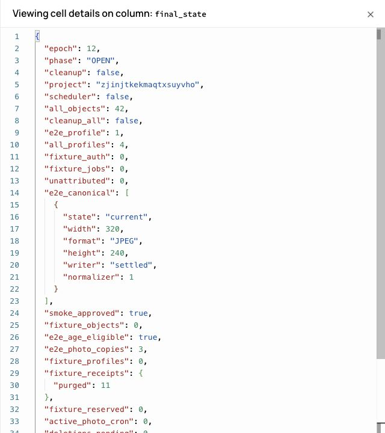

# PHOTO canary lease resolution + final re-run — 2026-10-18

**GO tecnico al proseguimento della roadmap staging.** Canary e delete completati; admission
staging OPEN epoch12, cleanup e scheduler OFF. Nessun task successivo avviato.

## Perimetro

Branch `codex/soma-schema-v2-staging`, baseline `5c7f012251ac1ef3050f5bca9d0c2a6f408824f7`.
Esclusivamente Supabase staging `zjinjtkekmaqtxsuyvho`.
Nessuna migration, nessun deploy, nessuna modifica a main o produzione, nessuna modifica runtime.
PHOTO-01/02, validator/decoder, MIME/formati/limiti, canonicalizzazione, retention, TTL,
admission policy e delete-account engine invariati. Nessun GCP o nuovo provider utilizzato.

Preview invariata: https://spot-4iyv0pnke-fedegrasso1994-1482.vercel.app/

- Deployment: `dpl_HbkVAv5TPEJa63RnuqXZNibMpaMi`.
- SHA del runtime pubblicato: `305cb4f8e625e9d331fd382089853ab350fe8cf5`.
- Nessuna nuova Preview necessaria: questo task modifica soltanto harness, test ed evidenze.
- Credenziali fixture soltanto nel manifest locale ignorato, nessun token/sessione salvato nel report o repository.
- Test live tramite normale Auth/password delle due fixture già esistenti e public key staging.
  Nessuna lettura di service-role/API admin secret.

## 1. Audit iniziale read-only

Confermati epoch12 PAUSED, cleanup OFF, scheduler OFF, zero cron PHOTO attivi.
Inventario corrispondente alla baseline: 2 Auth fixture, 2 profili, 15 oggetti, 1 cancellazione pending;
zero writer incerti delle fixture, baseline non-fixture 3 profili/39 oggetti/3 review storici.
Ownership confermata da UID di Auth/profilo/job/ledger e prefisso delle key Storage nel manifest privato.

La lease responsabile del precedente 409 era del test negativo `[1,2,3]` della fixture **B**,
key con suffisso `af82d81e-b72f-47a9-90b9-c60b6ffcd90f.jpg`:

| Evento | UTC 2026-10-18 |
|---|---|
| Creazione ledger | 09:16:47.797502 |
| Expiry lease | 09:17:32.795740 |
| Delete precedente | 09:16:50.621957 |

Al precedente delete era validamente attiva, non una lease stale eliminabile arbitrariamente.
Il job era `failed`, writer `settled`; la barriera conserva il limite conservativo di 45 secondi
anche dopo un fallimento noto. Il successivo upload riuscito non cancella la lease di un altro job.
All'audit iniziale attuale tutte le lease fixture erano naturalmente scadute e
`photo_deletion_barrier(A/B)=false`. Nessuna modifica/cancellazione di lease necessaria o effettuata.

La cancellazione pending B non è stata rimossa/reset manualmente: ripresa idempotente mediante
il normale endpoint delete-account, nel solo allowlist canary.

## 2. Harness e pre-validazione

Il runner ora dispone di fasi finali esplicite:

1. `final-prepare`: preflight locale di tutte e cinque le fixture, login A/B e verifica 503 PAUSED/no-store.
2. `final-smoke`: normale completamento delete pending B; su A upload/replace, update metadati
   concorrente, lettura vecchia foto, invalid file + retry. Si ferma prima del delete finale.
3. Lettura separata server-side di job, lease, writer e `photo_deletion_barrier` tramite console staging.
4. `final-delete`: una sola richiesta normale di cancellazione A, con controlli server invariati.

Nessun polling/retry automatico di delete o nuova iterazione del canary. Un errore marca il manifest
`stopped` e impedisce resume automatici. Nuovo manifest separato con checksum del precedente;
vecchia evidenza di fallimento preservata. Preflight PHOTO-01 invariato eseguito prima del network
anche nelle fasi successive. L'endpoint delete resta l'autorità finale se lo stato cambia dopo la lettura.

**Pre-validazione 5/5 PASS**, validazione rigorosa input + decode + canonicalizzazione invariati.

## 3. Unica iterazione finale live

Guardie immediatamente prima di CANARY: ambiente staging, epoch12 PAUSED, cleanup/scheduler OFF,
nessun writer non classificato fuori review, nessun legacy writer, nessun current mancante,
nessun cron attivo. L'unica deletion pending ammessa era quella esplicitamente classificata della
fixture B, con barriera già false; nessuna cancellazione pending diversa ammessa.
Controller esistente `photo_cutover_set('canary',...)`, allowlist solo A/B.

| Verifica | Esito / evidenza UTC |
|---|---|
| Preflight 5/5, login reale A/B, PAUSED 503/no-store | PASS 09:25:14 |
| Normale ripresa delete pending B | PASS HTTP200 09:25:46 |
| Upload A, canonicalizzazione, update metadati durante upload | PASS 09:25:50 |
| Vecchia foto leggibile durante e dopo replace | PASS |
| File invalido rifiutato, retry valido canonicalizzato/pubblicato | PASS 09:25:53 |
| Lettura separata: nuova lease failed ancora attiva → nessun delete | PASS |
| Lettura dopo expiry naturale: barrier A/B false, unknown fixture0 | PASS |
| Normale delete finale A | PASS HTTP200 09:26:52 |
| Login fixture cancellate rifiutato | PASS |
| Post-delete integrità e quota | PASS |

La nuova lease del test negativo A, creata alle **09:25:50.435025**, scadeva alle
**09:26:35.433804 UTC**. È stata osservata attiva con barriera true; il runner non ha chiesto delete.
Dopo la scadenza naturale una nuova lettura ha confermato barriera false e writer tutti settled;
solo allora è partita la richiesta finale. Non si è usato il solo clock del client come permesso.
Un writer unknown resta bloccante anche dopo expiry; i review storici non sono stati toccati.

Nessun TTL ridotto, nessun reset job/lease, nessun bypass del 409, nessuna modifica al delete engine,
nessuna attivazione del cleanup globale o scheduler. Il cleanup sincrono dell'account eseguito dal
normale delete endpoint è quello già previsto dal controller per gli owner canary, distinto dal collector globale.

## 4. Post-delete e riapertura

Prima della riapertura verificati:

- Auth fixture0, profili0, oggetti0, job0, foto validate0.
- Reserved bytes fixture0, cancellazioni pending0, writer incerti fixture0.
- 11 ledger receipt `purged`, writer settled, manifest null, reservation0: metadata tecnici,
  non foto o dati prodotto recuperabili. La retention esistente è 7 giorni/eligibilità al ciclo normale;
  non è stata forzata e con scheduler OFF non si promette purge automatico in quella finestra.
- Baseline non-fixture invariata prima dell'E2E: 3 profili, 39 oggetti, 3 review storici.

Transazione con ulteriori guardie su assenza fixture/storage residui, nessun unexpected unknown,
nessuna deletion pending, tutte le copie correnti presenti:
`approve_smoke` → `open` attraverso `photo_cutover_set` esistente.
Controller ha accettato le prove reali di upload/replace/delete; nessun smoke receipt inventato.

**OPEN epoch12, smoke_approved=true**, execute/cleanup=false, cleanup_all=false,
scheduler=false. Nessun comando execute_on/execute_all/scheduler ON eseguito.

## 5. E2E reale Preview

Usata la sessione reale già autenticata dell'utente nella Preview, inizialmente senza profilo.
Eligibilità 18+ e consenso erano già confermati: sono stati preservati e verificati validi server-side.
Non è stato creato un nuovo account reale, non è stato ripetuto un login Google, né accettato nuovamente
un consenso per conto dell'utente. I due login sintetici reali sono verificati separatamente nel canary.

| Passaggio UI | Esito |
|---|---|
| Auth session reale presente; guardie AGE/consenso rispettate | PASS |
| Crea profilo con dati già inseriti dall'utente | PASS |
| File chooser reale, JPEG sintetica seed40 | PASS |
| Entra → upload Edge → canonicalizzazione → INSERT profilo | PASS |
| Pagina Tribe opzionale, Salta per ora | PASS |
| Ingresso app Ora senza presenza automatica | PASS |
| Refresh → sessione ripristinata, ingresso app senza rifare onboarding | PASS |
| Profilo: foto canonicale effettivamente visibile | PASS screenshot/ispezione visiva |
| Modifica profilo → Salva modifiche con foto corrente, nessun nuovo upload | PASS |
| Navigazione Ora e Tribe vuota, scelta Tribe accessibile | PASS |

Server conferma un solo profilo E2E, AGE eligible=true, consenso valido=true,
JPEG320×240, normalizer1, lifecycle current/settled, tre copie presenti.
Questo profilo è intenzionalmente il profilo staging dell'utente: preservato, non una fixture sacrificabile.
Nessuna foto reale caricata: è stato usato il gradiente sintetico. Nessuna presenza/Tribe/match creata
arbitrariamente sull'account dell'utente. Nessun QR live eseguito in questo task.

Limite di evidenza: non è un nuovo signup con una nuova acquisizione di consenso o un test su dispositivo
fisico; è il percorso reale Preview da account autenticato/conforme a nuovo profilo, con refresh.
La regressione delle altre varianti Auth/AGE/consenso e Ora/Tribe è coperta dalla suite completa.
Nessun cambiamento UI/CSS o redesign.

## 6. Stato finale

- Admission staging **ON / OPEN epoch12**, smoke approvato.
- Cleanup globale **OFF**, scheduler **OFF**, cron PHOTO attivi0.
- Due fixture completamente eliminate via normali cancellazioni: Auth0, profili0, oggetti0, job0,
  validated0, quota riservata0; solo 11 ricevute tecniche minime come sopra.
- Staging complessivo: 4 profili e 42 oggetti = baseline3/39 + profilo E2E1/3.
- Oggetti non attribuiti0, copie correnti mancanti0, unexpected unknown0, deletion pending0.
- Tre review storici invariati: non sono nuovi writer incerti e non sono stati purgati.
- Confirm email non modificato; nessuna modifica Auth console eseguita.
- Production/main/PHOTO-01/02 invariati; Spot v2 non iniziato.

## 7. Test e versione

Nuovo test Postgres locale: il retry riuscito non elimina la failed-job lease ancora valida;
claim delete negato prima della scadenza, barriera false dopo expiry simulata esclusivamente nel DB
locale del test; un writer unknown torna/resta bloccante anche con lease scaduta.
Nessuna simulazione o modifica del tempo nei dati live staging.

- Suite completa: **421/421 PASS**, zero fail/skipped.
- Build: **PASS**.
- Typecheck: **PASS**.
- Targeted preflight + lease regression: **2/2 PASS**.
- Diff src/, supabase/, index.html, package e lock rispetto alla baseline: vuoto.
- Harness/test/report versionati sul solo branch staging; nessun nuovo runtime da deployare.

**GO tecnico per il gate PHOTO staging**, con i limiti di evidenza E2E dichiarati sopra.
Restano i normali gate legali/prodotto della roadmap, non riaperti da questo task. STOP.
