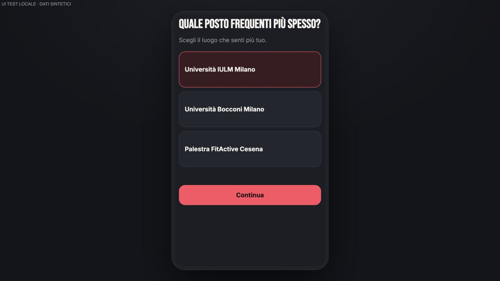

# SOMA IA pilot alignment — follow-up closure, 2026-10-18

Baseline: `codex/soma-schema-v2-staging`, `2b7e0fdef2068bb28f95d69a62ba32e5345ef057`.
Read `SOMA_PRODUCT_UX_SOURCE_OF_TRUTH.md` before implementation. Staging only.

## Exact change

- Removed “Salta per ora” from pilot Tribe onboarding and removed its completion handler.
- Continue disabled without a selection; the handler also refuses direct invocation without a
  selection or existing membership. Existing members are preserved, not forced into another join.
- Exactly one local selection. Continue calls existing `join_tribe` then `complete_onboarding`;
  routes directly to TRIBE. Failed join cannot complete. Successful join + completion retry does
  not create a duplicate join. No schema/RPC/RLS/max3 changes, no style changes.
- Existing completed-but-zero-membership standard accounts must select a Tribe too.

## QR exception

Pending external Place QR is preserved through Auth and required profile/photo onboarding. With
AGE and active dating consent, it is consumed via existing ORA QR RPC before requiring Tribe
completion. No `complete_onboarding` or `join_tribe` for that QR flow. No second presence screen.
Refreshing an active ORA session with zero Tribes restores ORA. Entering TRIBE/SPOTTED then opens
Tribe selection. Missing AGE/profile/consent and invalid QR remain controlled; no legacy writer.
QR validity/ownership/presence stay server-authoritative. No auto-join or new QR issuance.

## Verification

- Full suite: **438/438 PASS**, zero fail/skipped.
- Build staging PASS, typecheck PASS, diff whitespace check PASS.
- Tests: no Skip; disabled/direct-invocation guard; single choice; each of IULM/Bocconi/FitActive
  joins then TRIBE; unavailable catalog/failed join; retry/concurrent Continue; legacy membership;
  external QR through signed-out Auth/draft/profile then ORA; no join/completion/second confirmation;
  refresh active zero-Tribe ORA; later SPOTTED requires Tribe; AGE/consent and invalid QR guards.
- Existing real local Postgres Membership Engine max3/fourth-denied/concurrency tests PASS.
- Auth/PHOTO/ORA/core regressions included in full suite.
- Browser local DEV fixture PASS: no Skip, Continue initially disabled, selecting IULM enables it,
  Continue opens TRIBE. Explicitly synthetic; not a new real signup or live QR E2E claim.

## Frozen scope

PHOTO-01/02, max3 backend, ORA four-hour/switch/QR semantics unchanged. No new backend deployment,
DB change, Spot v2, quotas, DD engine, Spotted v2, authorization v2, jobs or other roadmap work.
Main and Production must remain unchanged. Preview deployment evidence appended after publication.
