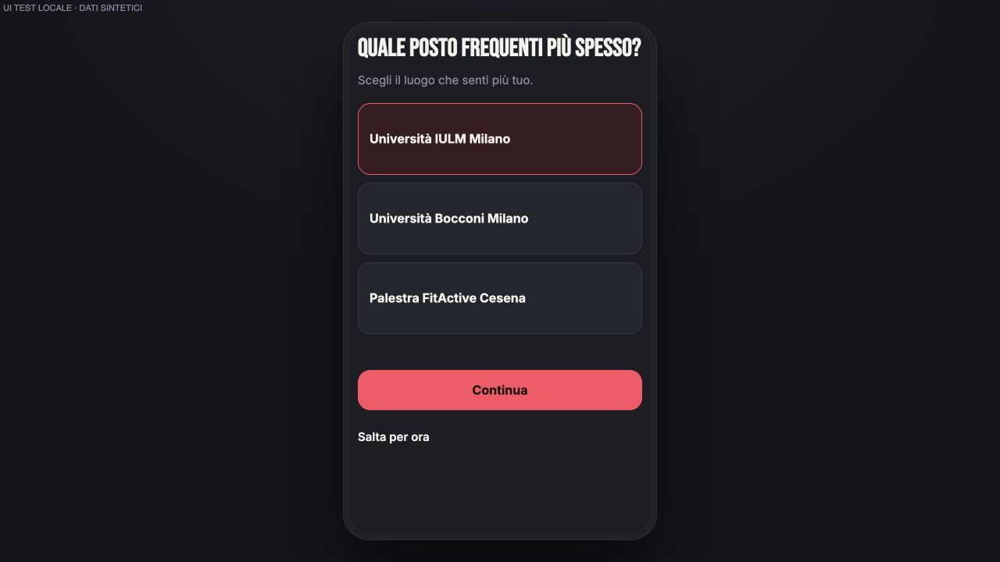
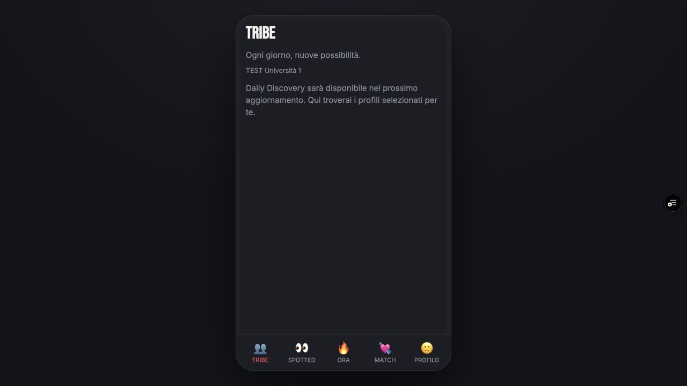
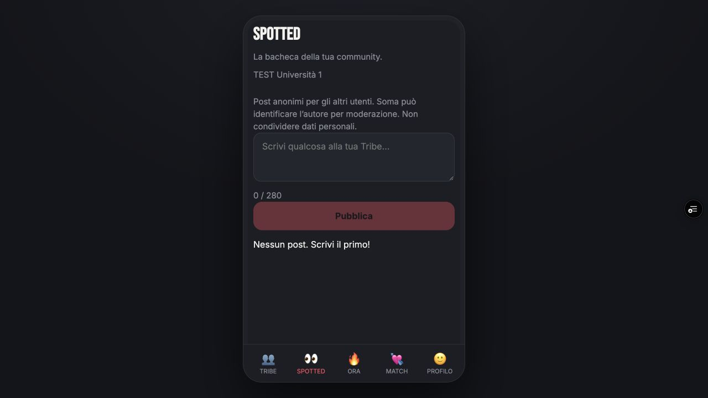
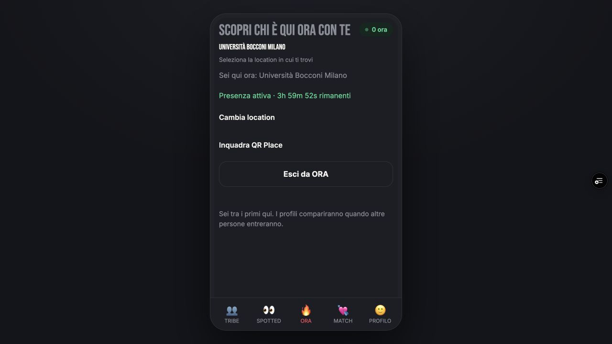

# SOMA Information Architecture + Pilot UI Alignment — 2026-10-18

Scope: staging only, branch `codex/soma-schema-v2-staging`, baseline
`b03f29257d8b2404d5be996a41ece979966e3ffe`. Nessun merge main, produzione o deploy backend.
Nessuna migration/schema/RLS/RPC modificata. Nessun Spot v2, quota enforcement, allocation DD,
Spotted v2, scheduler o modifica PHOTO-01/02.

## Architettura e visual language

Nuovi moduli dedicati `pilot-ui.js`, `pilot-onboarding.js`, `pilot-ora-ui.js` e CSS esclusivamente
scoped. Shell attiva quando sono presenti i backend onboarding/ORA v2 già limitati allo staging.
Produzione legacy e demo restano separati. Nessun nuovo design system: palette, font, radius,
componenti condivisi e profilo/Auth/PHOTO preservati. Design freeze aggiunto ad AGENTS.md.

| Area | Prima | Dopo |
|---|---|---|
| Bottom nav | Ora / Tribe / Match / Chat / Profilo | TRIBE / SPOTTED / ORA / MATCH / PROFILO |
| Onboarding Tribe | Ricerca, aggiunta immediata, max3 UI | Tre card pilot, unica scelta locale, join al Continua, skip |
| Post-onboarding | Ora | Tribe, anche dopo skip e senza loop |
| Tribe | Menu community, directory Persone, Bacheca | Stato Daily Discovery preparatorio, nessun profilo inventato |
| Spotted | Bacheca sotto Tribe | Tab indipendente, medesime RPC/reactions/report/retention legacy |
| Ora | Ricerca Places da avviare | Catalogo visibile automaticamente, tap manuale esplicito, live/residuo/exit |
| Match | Due tab Match e Chat | Una sezione; vecchie route chat-list confluiscono in Match |
| Profilo | Versione approvata | Invariato |

## Contratti preservati

- Membership engine max3 invariato; pilot limita solo una nuova scelta UI. Membership preesistenti
  non vengono eliminate né sostituite. Skip non salva la scelta ancora locale.
- Il retry dopo complete fallito non duplica un join già riuscito. Double-tap serializzato.
- Tribe non legge più la directory e non monta il selettore Persone/Bacheca nella nuova shell.
  Nessun countdown DD, quota DD, refill o contatore falsamente live.
- Spotted riusa `mountBoard` in modalità standalone e le stesse API legacy. La scelta community,
  se più membership esistono, serve soltanto a contestualizzare quel feed; non cambia membership.
- Ora usa solo search_places/start_ora_manual/my_presence/end_ora già esistenti.
  Nessun auto-start, nessun rinnovo client, nessun auto-join Tribe.
- Residuo ORA calcolato dal delta expires_at/server_now con tempo monotonic elapsed. Timer solo UI;
  quattro ore, retry stesso Place, switch atomico e scadenza rimangono server-authoritative.
- Nessuna quota futura attivata o mostrata come effettiva. send_spot_v2 non implementata.
- Match usa lo stesso ID e la stessa chat. first_message_at null mostra “❤️ Nuovo match!”;
  dopo messaggi mostra “Conversazione avviata” (o last_message se il contratto lo fornirà), senza
  inventare un testo messaggio o introdurre nuove letture/API backend per le preview.
- Vecchie route tribes/tribe → daily, chats → matches nella shell pilot. History normalizzata;
  i guard Auth/AGE/suspension/deletion comprendono entrambe le nuove route.

## Catalogo staging approvato e applicato

Autorizzazione founder: “Sì, aggiungi le tre voci staging”. Applicato esclusivamente a
`zjinjtkekmaqtxsuyvho` lo script versionato `supabase/staging/pilot-catalog.sql`.
Non è una migration: inserisce tre Place con Tribe collegata, attivi, joinable e ORA-enabled:

| ID | Nome |
|---|---|
| fa350000-0000-4000-8000-000000000001 | Università IULM Milano |
| fa350000-0000-4000-8000-000000000002 | Università Bocconi Milano |
| fa350000-0000-4000-8000-000000000003 | Palestra FitActive Cesena |

TEST Università 1/2 e membership esistenti preservate. Nessun QR inventato, nuova membership,
modifica schema o flag. Mapping UI solo per nome esatto/univoco, mai per posizione.
Test Postgres locale verifica inserimenti/link, conservazione catalogo/flag, rifiuto riesecuzione
con collisioni e rifiuto environment production. Nessuna esecuzione SQL sulla produzione.

## Verifiche

- Suite completa: **434/434 PASS**, zero fail/skipped.
- Build staging: PASS. Typecheck attuale repository: PASS.
- Targeted UI/navigation/social e integrazione PASS.
- Nuovi test: onboarding per ciascuno dei tre luoghi, unica selezione, skip senza join,
  retry/double-submit, nessuna rimozione membership legacy, mapping catalogo esatto,
  nav order/alias, DD senza letture directory, Spotted indipendente da Persone,
  ORA senza ricerca/Tribe, tap/exit e residuo monotonic server delta.
- Integrazione controller: scelta → Tribe anche con presenza Ora già attiva; skip → Tribe;
  Ora ancora raggiungibile con zero Tribe. Regressioni Auth/PHOTO/AGE/consent/membership/Ora/Bacheca/social
  incluse nella suite esistente.
- Browser locale DEV con fixture esplicitamente sintetiche: card/selection, scelta→Tribe, skip→Tribe,
  Spotted standalone, zero Tribe→Ora, start/exit PASS. Nessuna evidenza Auth/Storage reale attribuita ai mock.
- Fixture DEV in scripts/pilot-fixture, HTML generato solo nella directory test ignorata; non nel bundle Preview.
- Bundle scan: ref staging presente, ref produzione assente, fixture DEV assenti.

## Deployment e smoke browser

- Preview: https://spot-n1ny1sqd5-fedegrasso1994-1482.vercel.app/
- Deployment: `dpl_8bc4ZavujuvqC66TmzTbbBs9mJLx`, target Preview, READY.
- Commit runtime: `90776d268c5a6d554377cbccbf9ff4774fe5d68b`, push precedente al deploy.
- Build-info conferma staging `zjinjtkekmaqtxsuyvho`, shell pilot/onboarding/ORA/legacy Bacheca ON;
  Spot v2, Daily Discovery engine e quota enforcement OFF.
- Release audit PASS: 40 file, 9 font locali; ref produzione e fixture DEV assenti dal bundle.
- Vercel Authentication della Preview preservata.
- Aggiunto soltanto il redirect staging esatto
  `https://spot-n1ny1sqd5-fedegrasso1994-1482.vercel.app/**` all'allowlist Auth staging.
  Site URL precedente invariato; Confirm email ON, Google provider ON. Nessuna attività GCP.

| Verifica | Evidenza / risultato |
|---|---|
| Google login → callback → nuova Preview | PASS reale, sessione autenticata, nessun redirect Production |
| Bottom nav / Tribe / Spotted / Match | PASS browser reale, nessun tab Chat duplicato o selettore Persone |
| ORA catalogo / Bocconi start manuale | PASS reale su nuovo Place staging |
| Refresh sessione/presenza | PASS reale, residuo diminuisce senza rinnovo |
| Esci da ORA | PASS reale; verifica finale zero presenze nei tre nuovi Places |
| Onboarding ciascuna scelta / skip / retry | PASS test automatici e browser DEV sintetico; non tre signup live |
| Zero Tribe → ORA | PASS automatico/DEV; non attribuito a nuovo account reale |
| Foto/Auth/social/server lifecycle | Suite regressione PASS; nessun nuovo upload foto/live match scritto in questo task |
| Mobile | Viewport UI e screenshot nel browser; non collaudo su telefono fisico |

Il tester Google aveva già TEST Università 1: la membership è preservata. Le tre nuove Tribe
hanno zero membership aggiunte arbitrariamente. Nessuna fixture Auth/post/chat creata nello smoke.
Console Preview: zero errori rilevati. Nessun backend nuovo deployato.

## Stato finale e limiti

- PHOTO staging OPEN epoch 12, cleanup OFF, scheduler OFF: invariati.
- Flag server esistenti invariati: jobs_paused true, ora_enabled true, membership_enabled false;
  spot/discovery/comments/requests/system_posts/share false. Nessun nuovo engine attivato.
- Nessuna presenza lasciata dallo smoke; nessun auto-join. I record catalogo approvati restano intenzionalmente.
- Main invariato `d0f515e8d2c80eeae60f2d5c33dd8901558d5287`.
- Deployment Production prima/dopo identico `dpl_6jX7jKUxcEFvieWoBdN6KS9i3Juh`.
- Il commit successivo al runtime contiene solo script catalogo, test, report ed evidenze;
  non richiede nuovo deploy frontend. Il runtime SHA resta distinto dal commit documentale finale.

**GO tecnico sullo scope richiesto; GO WITH CONDITIONS rispetto al nuovo documento prodotto. STOP prima di Spot v2 e quote ORA.**
Daily Discovery è una shell preparatoria esplicita, non un motore implementato.
Nessuna attestazione di pilot/legal readiness o di E2E live di tutti i nuovi signup.

## Evidenze visuali

Onboarding DEV, esplicitamente sintetico:

Preview reale, membership TEST preesistente:

Preview reale, presenza Bocconi poi terminata tramite Esci da ORA:

## Aggiornamento remoto concorrente e differenza prodotto

Durante il push finale è stato trovato il commit remoto `8974c874ad9503cb8fac55d78e4dec1edfb43a26`,
che aggiunge `SOMA_PRODUCT_UX_SOURCE_OF_TRUTH.md`. Preservato integralmente tramite rebase
non distruttivo del solo commit locale di catalogo/test/evidenze; nessun force push.
Il documento è stato letto. Sezioni 3/6/7 richiedono Tribe obbligatoria senza skip nel percorso
standard ed eccezione QR: differiscono dallo scope esplicito di questo task, che includeva Skip.
Il codice deployato mantiene lo Skip richiesto e testato. Nessuna implementazione opportunistica
sulla base del documento appena arrivato; allineamento mandatory-Tribe/QR da task successivo esplicito.
Questo impedisce di dichiarare pieno allineamento al nuovo Product/UX Source of Truth.
Il resto delle feature future elencate nel documento non è stato attivato.

## Follow-up closure

The skip condition and QR exception are addressed by the narrow follow-up documented in
[soma-ia-pilot-gate-closure-2026-10-18.md](soma-ia-pilot-gate-closure-2026-10-18.md).
Earlier sections record the previous deployment, not the new runtime.
