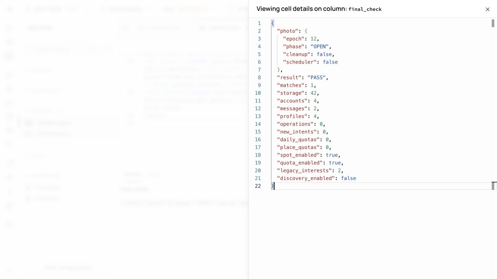
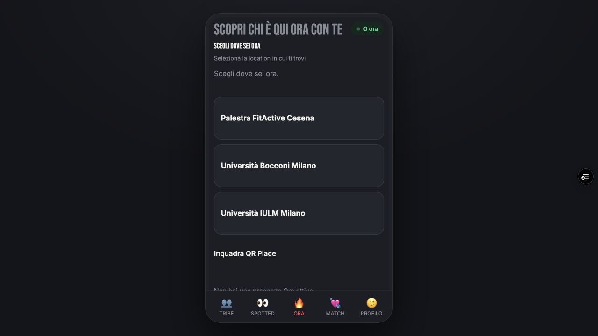

# Spot v2 + ORA quota enforcement — staging report

## A. Baseline / environment

`codex/soma-schema-v2-staging`, starting HEAD `ab532d99b11b9f366cf7186d8363ea861e545c79`;
clean working tree. `SOMA IA PILOT ALIGNED: GO`. Product source of truth read and unchanged.
Only Supabase `zjinjtkekmaqtxsuyvho`. Main local/remote remains
`d0f515e8d2c80eeae60f2d5c33dd8901558d5287`. Production reference remains
`dpl_6jX7jKUxcEFvieWoBdN6KS9i3Juh` (read-only verification; no Production operation).

## B–M. Implementation

Detailed API/schema/locking/privacy contract:
[soma-spot-v2-contract-2026-10-18.md](soma-spot-v2-contract-2026-10-18.md).

| Area | Result |
|---|---|
| Legacy audit | Context-keyed old send_spot and alias retired; express_interest retired; INSERT fence prevents old in-flight writers |
| Data model | Private person-level intent ledger + operation receipts; unique pending direction, context metadata separate |
| Pending/idempotency | 30 elapsed days; same operation stable; new operation reuses valid pending; original timestamps preserved |
| Reciprocity | ORA/ORA, ORA/TRIBE, TRIBE/ORA, TRIBE/TRIBE supported with authorized context |
| Match | Reuses existing UNIQUE pair Match and existing chat/messages; no reset/duplicate relationship |
| ORA context | Auth sender/current shared live Place/presence derived server-side; no caller Place/date/sender |
| Quota | Atomic 5/day global +3/day/current Place; new reciprocal ORA charged once; reuse/failure/rollback not charged |
| Date | Server Europe/Rome local date; winter/summer/DST cases tested; elapsed Spot validity remains 720 hours |
| Concurrency | Existing global board lock + sorted account pair locks + atomic writes; fixed snapshots explicitly refused by035 |
| Legacy rows | Old interests left intact; known unexpired pending can be imported without invented timestamps/context |
| Tribe leave | Only sender's pending in exact departed membership invalidated; received/ORA/matched unaffected |
| Security | RLS/no direct client writes, no service grants, fixed search_path, Auth/AGE/consent/block/status gates |
| Frontend | Dedicated staging-only Spot API, existing ORA CTA enabled, operation reused after error, neutral quota errors |
| Rights/delete | Own v2 intents exported; private receipts excluded; erasure cascades and other user's quota not refunded |

No styles, navigation/onboarding/QR UX, PHOTO decoders/lifecycle, historical migrations001–033,
product source-of-truth, Match/chat frontend, DD allocator or quota, Spotted requests, notification,
analytics, retention/scheduler or provider changes.

## N. Automated verification

**461/461 PASS**, zero fail/skipped. Build PASS, typecheck PASS, diff whitespace check PASS.
New `tests/spot-v2.test.js`: 22 tests/groups cover mandatory engine matrix; plus one new social UI
regression for retry operation identity/double tap and no legacy fallback. Existing438 tests retained.

- Core pending/retry/new op/no renewed age/expiry/reciprocity/unique existing Match.
- Four surface combinations; no real exposure → Tribe rejected, unready/wrong pair rejected.
- ORA absence/different Place/expiry/block/consent and crafted context/legacy-origin injection.
- Global5/Place3, switch/reentry, reciprocal charge, existing pending/Match no charge.
- Failure injected after counter increment + transaction rollback: no persisted partial state.
- Europe/Rome actual date and both DST transitions.
- Legacy pending original date/context retained; Match/messages unchanged.
- Grants/RLS/private writes/legacy bodies+insert fence; pause fails closed.
- Leave exact membership, matched relationship preserved; own rights and account FK erasure.
- READ COMMITTED-only writer, stale fixed snapshots rejected before mutation.
- Hosted fixture/setup/smoke/teardown and cross-surface scripts rehearsed locally.
- Auth, PHOTO, membership, onboarding, ORA, Board/Spotted, rights/delete/moderation regressions in suite.

Single-connection PGlite Promise.all tests are explicitly labeled queued rehearsals, not MVCC proof.

## O. Real PostgreSQL staging smoke

`tests/staging/spot-v2-smoke.sql` executed as authenticated SQL principals with real public RPCs.
Pending, retries, credits1–5, sixth denied, same-Place1–3/fourth denied, switch/reentry,
reciprocal charge, one Match, send_message, own RIGHTS, legacy denied PASS. Whole smoke rolled back.

Two independent SQL Editor sessions, distinct PostgreSQL backend PIDs:

| Race | Observed result |
|---|---|
| Place last slot | One winner, other PLACE_QUOTA; final global3/place3/intents3. B won first scheduling order; A's quota error is expected |
| Global last slot | A PID1191774, B1191779; B waited4.704s then DAILY_QUOTA; global5/intents5/maxPlace3 |
| Same pair, different operations | A1191799/B1191800, B waited7.432s; one intent, one charge, two receipts |
| Opposite ORA directions | A1191842/B1191843, B waited7.645s; one Match, two matched intents, two charges |
| Existing Match concurrent retry | A1191864/B1191865, wait7.658s; same Match ID, same two charges |
| ORA / TRIBE reciprocal | A1191903/B1191904, elapsed7.633s; one Match, two intents, only one ORA charge |

TRIBE test uses a synthetic ready exposure/current memberships. Discovery/policy flags are changed
only inside the test transaction and restored BEFORE commit; no globally visible DD enablement or
profile allocation. Final discovery_enabled=false, policy enabled=false.
Live fixed-snapshot rejection test also PASS with rollback and zero writes.

[Captured SQL result evidence](evidence/spot-v2/staging-races.json).

These are real database/authorization/locking tests, not new browser signup/Google/MFA/PHOTO uploads
or two physical-device tests. Those are not falsely marked PASS by the SQL fixtures.

## P. Fixture teardown / final state

12 clearly marked synthetic SQL principals and two synthetic Places removed using guarded teardown.
No credentials generated/extracted, no Storage file created, no test Auth setting changed.

| Item | Before | After |
|---|---:|---:|
| Auth accounts | 4 | 4 |
| Profiles | 4 | 4 |
| Legacy interests | 2 | 2 |
| Match | 1 | 1 |
| Messages | 2 | 2 |
| Photo Storage objects | 42 | 42 |
| New v2 intents/operations | 0 | 0 |
| ORA quota rows | 0 | 0 |
| Synthetic Auth/ledger/receipts/quota/Storage residue | 0 | 0 |

Controlled window/exposure and fixture photo metadata removed. Zero new orphan or dangling FK from
this task; no claim that old lifecycle-pending objects were globally purged. Existing photos/presences
untouched. PHOTO OPEN epoch12, cleanup OFF, scheduler OFF; jobs_paused=true. Spot and ORA quota policy
ON in staging intentionally; discovery/comments/requests/share/system-post flags remain OFF.
Final `spot-v2-check.sql` verifies integrity, grants/RLS, caps, flags and fixture absence: PASS.

## Q. Migrations / rollback

034 applied once in staging: additive ledger/receipt/fence tables, RPC/budget, RLS/grants,
legacy writer retirement+insert fence, leave hook, own rights projection. 035 applied once:
explicit fixed-snapshot guard. Historical migrations untouched.
An initial SQL Editor replacement left old text in the Monaco buffer and produced syntax error
before DDL. Replacing the whole buffer via editor Select All + Paste resolved it; no partial migration.
No unexplained database errors after successful execution. Expected quota/auth denials are test results.

Operational rollback: Spot server flag OFF + quota policy OFF; optionally Preview client flag OFF.
Keep all new schema/data and legacy fence. No destructive down migration, no return to old writer.

## R–U. GitHub / Preview

Source commit is pushed before Preview deploy. Runtime SHA, URL/deployment ID and final repository
checkpoint are appended after deployment. No main merge or Production deployment permitted.

## V. Remaining boundaries and gate

Full profile/photo authorization v2 remains the next separate gate; existing broad legacy Tribe photo
reads are preserved, not enlarged. Physical retention for v2 ledger/receipts/quotas is not selected or
activated here. Global lock is conservative; broader throughput/load still needs operational measurement.
These are bounded roadmap dependencies, not hidden completion claims. Legal/pilot readiness remains separate.

**GO to PROFILE / PHOTO AUTHORIZATION V2**. Final Preview verification is recorded below.
Do not start that task automatically. STOP after versioning, staging evidence, report and push.

## Final Preview / source checkpoint

- Runtime/code commit pushed before deploy: `14f9ed5b839aa5b07f319c86dc50939b44eafb10`.
- Preview: https://spot-c96u3c029-fedegrasso1994-1482.vercel.app/
- Deployment: `dpl_GC6ZRmtT4Zk9vCvAdJzEN4m6ZSvw`, READY, Preview only, no production URL.
- Browser build-info confirms full SHA, staging ref, Spot v2 and quota enforcement true,
  Daily Discovery engine false. Release check PASS: 40 assets, 9 self-hosted fonts; no test fixture,
  server secret or Production ref in bundle.
- Added only exact staging Auth redirect `https://spot-c96u3c029-fedegrasso1994-1482.vercel.app/**`.
  Site URL unchanged; provider/Confirm email configuration unchanged, Google ON, Confirm email ON.
- First browser Google readiness attempt failed during transient local/client connectivity trouble.
  System hostname lookup returned ENOTFOUND while DNS A records were resolvable; direct DNS diagnostic
  with normal HTTPS/SNI/certificate verification returned Auth settings HTTP200, Google enabled,
  Confirm email enabled. Browser direct diagnostic navigation reported ERR_BLOCKED_BY_CLIENT.
  No DNS/hosts/network/browser or app workaround applied. A later normal system lookup resolved;
  controlled browser Google retry succeeded, callback to THIS Preview and authenticated TRIBE.
  Exact underlying cache/filter cause is not established. This was a recovered diagnostic condition,
  not grounds to alter Auth, Google Cloud or Spot semantics. No Production redirect.
- Production deployment before/after identical `dpl_6jX7jKUxcEFvieWoBdN6KS9i3Juh`.
- Main local/remote unchanged `d0f515e8d2c80eeae60f2d5c33dd8901558d5287`.
- Browser refresh retains authentication; TRIBE restores the existing TEST Università 1 membership.
  ORA loads exactly the three approved pilot Places, with no active presence and no synthetic Places.
  No real presence/Spot/message was created for that browser check. Console error/warn capture empty.
- Extra post-teardown counts also zero for synthetic eligibility, consent, onboarding, memberships,
  presences, validated-photo records, lifecycle sets, photo cleanup/audit, exposures, matches/messages.
  The non-personal global fence revision intentionally remains monotonic; it is not fixture data.
- Final documentation commit follows the runtime commit; no runtime change or extra deploy required.

**Final gate: GO to PROFILE / PHOTO AUTHORIZATION V2.**
Spot v2 server/quotas, staging smoke and fixtures gate closed; next task not started.

